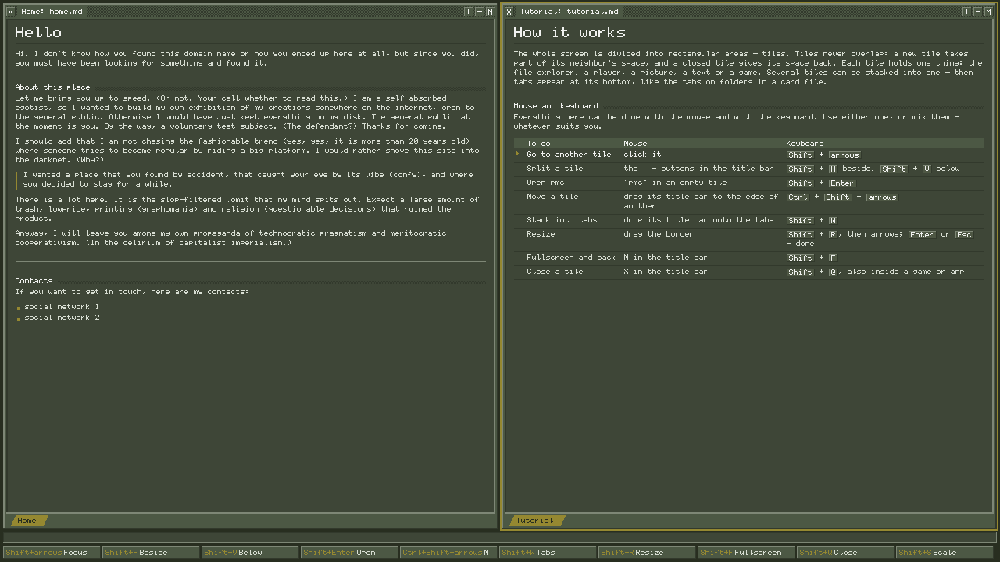
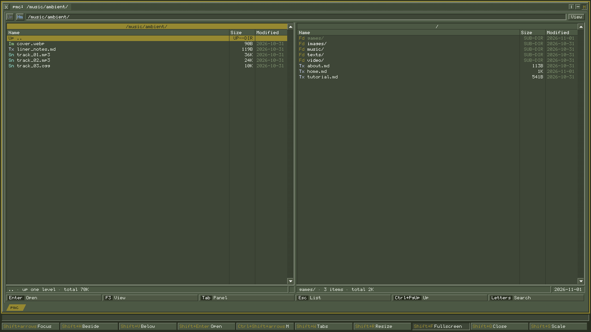
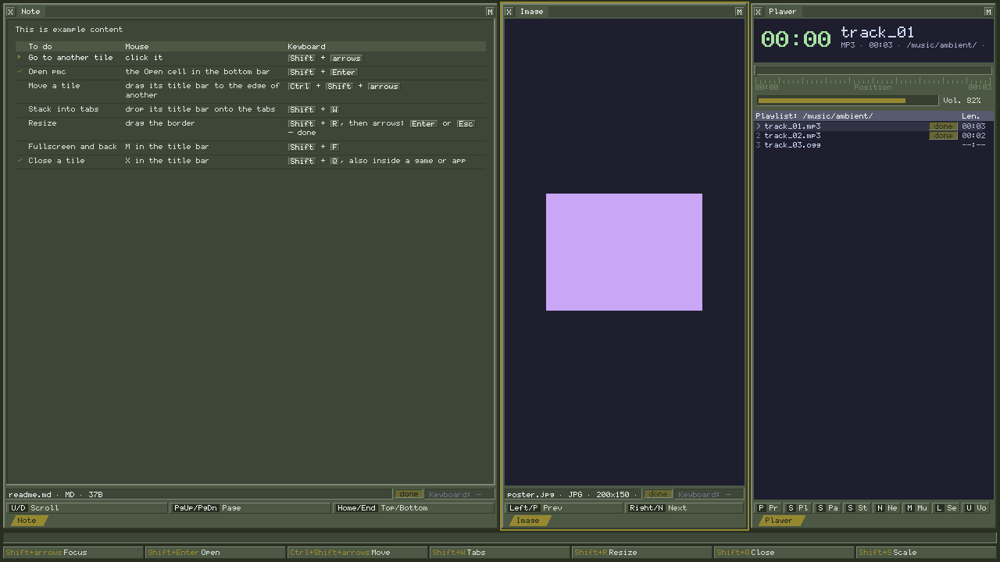

# MILK-FUMO

A personal portfolio site shaped as a tiling window manager. The browser window is divided into tiles, as in i3: the tiles hold a file browser over the published content, notes, audio and video players, and web games. The content is a plain directory on the owner's server, served by nginx.



- The site is in [`site/`](site/): plain JavaScript modules, one `<canvas>`, no npm dependencies and no build step.
- [`docs/prototypes/`](docs/prototypes/) holds the clickable prototypes the design decisions were made on.

## Purpose

Within the first minute a visitor should:

1. see whose site this is;
2. understand that it is a tiling desktop and learn to use it;
3. browse the portfolio and open any file from it.

**Everything can be done with the keyboard, with the mouse, or with both.** Every action has both ways. The original i3 is keyboard-only; here the choice is left to the visitor.

**The site is read-only for visitors.** They open files, play, seek and rearrange tiles, but they write nothing to the published content. The owner publishes new work over SFTP. Write protection comes from server file permissions, not from missing buttons.

## Sources

| Source | What is taken |
|---|---|
| [bird-fumo](https://github.com/vydramain/bird-fumo) | viewers and launching: explorer, images, audio, video, web apps; the app `postMessage` protocol (without its privileged messages) |
| [3dmppc-editor](https://github.com/vydramain/3dmppc-polymer/tree/master/editor) | the workspace: tiles, tabs, minimum sizes; the widget catalog and fonts |
| [vgui2-deck](https://github.com/vydramain/vgui2-deck) | palette; its fonts are used by the prototypes only |
| SGI IRIX | the look: raised frames, brass, dense utility type |
| Midnight Commander, Volkov Commander | the pmc UX: two panels, cursor, function keys |

Stitch, a generated draft, contributed the player queue (its split buttons were removed in v3). Its own palette, fonts, icons and telemetry decorations were dropped.

## How the site works

- The content is one directory on the server. The owner uploads files over SFTP; nothing has to run after an upload.
- nginx serves the site files and the content directory. The browser reads a folder as JSON from nginx's autoindex (name, type, size, modification time). Files are plain HTTP GET requests.
- Visitors only read, over HTTP. Only the owner writes, over SFTP.
- Nothing is remembered between visits, and nothing is left with the visitor.
- The whole interface is drawn by the site itself in one `<canvas>` with the Canvas 2D API. The UI is immediate-mode: every frame is rebuilt from the state, and a widget checks clicks on its own rectangle.
- Drawing happens on events, not 60 times a second, so an idle page does not load the processor.
- Notes are drawn in the canvas, so their text cannot be selected or copied.
- Audio and video elements are created by the script and are not inserted into the page; video frames are drawn into the canvas.
- Games and web apps run in an iframe placed over their tile's rectangle, loaded from the same origin as the site. This lets the site catch `Shift+Q` even inside a game.
- Pixel-perfect rendering: the canvas buffer matches the screen's physical pixels, all coordinates are whole pixels, smoothing is off, and text comes from bitmap font tables, not the browser's text engine.
- Chromium and Firefox are supported.
- Capacity: about 100 simultaneous visitors. The real limit is the server's outgoing bandwidth for video and music (viewers × bitrate).

## Controls

The modifier key is **Shift**. Keys are matched by physical position (`KeyboardEvent.code`), so they work in any keyboard layout.

Why Shift:

- Super is usually taken by the system or by the visitor's own i3, where `Super+Enter` opens a terminal.
- Alt reaches the browser, but the browser owns `Alt+←`, `Alt+→` and `Alt+D`.
- `Ctrl+Q` quits Firefox and `Ctrl+Shift+Q` quits Chrome, so closing a tile is `Shift+Q`.
- Ctrl+W, Ctrl+T and Ctrl+N cannot be caught by a page at all.

What Shift costs: it types capitals in text fields, it takes `Shift`+arrows and `Shift`+click selection, and the i3 `Mod+Shift` layer is gone (moving is `Ctrl+Shift`+arrows, closing is `Shift+Q`). Games often use Shift for running.

| To do | Mouse | Keyboard |
|---|---|---|
| Go to another tile | click it | `Shift` + arrows |
| Open or focus pmc | the **Open** cell of the bottom bar | `Shift+Enter` |
| Move a tile | drag its title bar to the edge of another | `Ctrl+Shift` + arrows |
| Stack into tabs | drop its title bar onto the tabs | `Shift+W` |
| Resize | drag the border | `Shift+R`, then arrows; `Enter` or `Esc` to finish |
| Fullscreen and back | `M` in the title bar | `Shift+F` (a video also: double click on its frame) |
| Close a tile | `X` in the title bar | `Shift+Q`, also inside a game or app |
| Restart an app | the **Restart** cell of its key bar | `Shift+0`, also inside the app's frame |
| UI scale 1x, 1.5x or 2x | the **Scale** cell of the bottom bar | `Shift+S` |

The environment bar at the bottom is always visible. It shows the key for each action, and every cell can be clicked. Every tile also ends with its own key bar, and its cells can be clicked too. Above it is a message line, for example one that says why a border will not move further.

## Tiles

- The screen is divided into rectangular tiles. **Tiles never overlap.**
- A new tile shares its neighbor's space 1:1. A closed tile gives its space back. There is no manual splitting: tiles appear by opening a file or with `Shift+Enter`.
- **One tile per type:** pmc, Player, Video, Image, Note. An app has one tile per app. Opening a file of a type that already has a tile focuses that tile and opens the file there.
- The title bar of a tile holds `X` and `M`. A tile's title is the app name only; the browser tab title follows the focused tile, and the favicon is `Mf`.
- The layout is a tree of splits whose leaves hold tabs. Stacked tiles show tabs at their bottom, like tabs on folders in a card file.
- A tile can be maximized to the whole screen and the layout restored.
- Dragging a title bar to the edge of another tile creates a neighbor; dropping it in the centre or on the tab strip stacks it into tabs. The future place is highlighted; `Esc` cancels.
- Rearranging does not restart a game or stop the music: app and player instances survive moving, stacking and maximizing.

### Start screen

Two tiles split the screen 1:1: the Note `readme.md` on the left and **pmc** on the right, focused. There are no buttons; the start screen is the tutorial. `readme.md` merges the author's text and the instructions (the old `home.md` and `tutorial.md` are no longer used), so the content root needs `readme.md`. Its path is set in [`site/js/config.js`](site/js/config.js).

The tutorial is written so that someone who knows i3 recognizes it, and someone who sees tiles for the first time learns how to use them. The table of actions marks progress: `✓` beside an action already done, `›` beside the next one to try.

## pmc

pmc (PSEUDO Midnight Commander) is the file panel. The UI is that of the editor's tiles; the UX is that of early Midnight Commander.



- **Two panels in one tile.** `Tab` switches the active panel. The path is written into each panel's top frame; the active panel's path is brass.
- **Cursor.** A full-width bar. `↑` `↓`, `PgUp` `PgDn`, `Home` `End`. The mouse wheel moves it 3 rows; a click puts it on a row. The inactive panel's cursor is dim.
- **Enter or double click:**
  - a folder — enter it; `..` goes one level up, and the cursor lands on the folder just left;
  - a folder whose name ends in `.exe` — an app; `Enter` launches it;
  - an app — a new tile for a different app; the tile of the same app is focused if it is open;
  - a file — if a tile of its type exists, it is focused and the file opens there; otherwise a new tile opens beside pmc. With the quick view showing a file of the same type, `Enter` opens it in the quick view.
- `Ctrl+PgUp` — one level up.
- **`F3` — quick view.** The other panel shows what the cursor is on: a folder's information, a track's player with its set, an image, a `.md` note, or an app's screen. `F3` on a file of another type replaces the viewer; on a file of the same type the same viewer opens that file. `F3` closes the quick view when the focus is on it or the cursor is on the file it shows; `Esc` brings the list back. `F3` on an app shows the folder's information. The quick view does not follow the cursor: it changes only by `F3` or `Enter`. (`F3` replaces MC's `Ctrl+Q`, which quits Firefox.)
- **Letters** — quick search by the start of a name; `Backspace` erases; `Esc` clears.
- **Columns** — Name, Size, Modified. Folders come first and show `SUB-DIR` instead of a size; `..` shows `UP--DIR`. A status line under the list describes the file under the cursor and the folder's total.
- There is no copy, move or delete: the site is read-only.
- The tile's bottom line is pmc's key bar: Enter Open, F3 View, Tab Panel, Esc List, Ctrl+PgUp Up, Letters Search. Every key in it can be clicked.
- The status line under each list shows the loading bar (`load`, `done`, `errr`).

## Tile types

| Type | Content | Reference |
|---|---|---|
| pmc | Published folders and files, two panels | [`explorer.html`](docs/prototypes/explorer.html) |
| Note | Markdown text | [`index.html#tiles`](docs/prototypes/index.html#tiles) |
| Audio player | Time, position, volume, playlist from the folder; tags (title, artist, album, year) in the header and the playlist | [`index.html#player`](docs/prototypes/index.html#player) |
| Video player | The audio player's top, then Fit / 1x / 2x and loop, and the frame; fullscreen | [`index.html#tiles`](docs/prototypes/index.html#tiles), [`index.html#fullvideo`](docs/prototypes/index.html#fullvideo) |
| App | A folder whose name ends in `.exe` and contains `index.html`: a web game in an iframe that fills the tile; `Shift+0` restarts it; a foot panel and a key bar below | [`index.html#tiles`](docs/prototypes/index.html#tiles) |
| Image | The selected image and switching through the folder's set | [`explorer.html`](docs/prototypes/explorer.html) shows the image without switching |



Every tile ends with a key bar; its cells are buttons (clicking `Seek` moves +5 s, `Volume` +5%). Tiles other than pmc and Player also have a foot panel: the file's line, the loading bar and a `Keyboard:` field.

| Tile | Key bar |
|---|---|
| Player | P Prev · Space Play · Space Pause · S Stop · N Next · M Mute · L/R Seek · U/D Volume |
| Video | the Player's cells plus L Loop before Seek |
| Image | Left/P Prev · Right/N Next |
| App | Shift+0 Restart · Shift+Q Close · Shift+F Fullscreen |
| Note | U/D Scroll · PgUp/PgDn Page · Home/End Top/Bottom |

**Loading.** The bar shows `load`, `done` or `errr` in the Player's rows, in the foot panels (Video, Image, Note, App) and in pmc's status line. Files are downloaded counting bytes and kept while the tile is open; the next file of the folder is preloaded; an `errr` file is retried when it is selected again. An app counts progress only by its `index.html`.

**Audio tags.** ID3v2 and Vorbis/Opus tags are shown in the Player header and in the playlist.

**Video fullscreen.** `Shift+F`, `M` in the title bar or a double click on the frame. On mouse move a panel with the position bar and the key bar appears and hides after 3 seconds; `Esc` or the same action returns. See [`index.html#fullvideo`](docs/prototypes/index.html#fullvideo).

### Main scenario

1. The visitor reads the start screen.
2. Uses pmc on the right, enters the music folder and opens a track: the Player appears beside it, pmc stays; the next track opens in the same Player.
3. Opens a game and places it.
4. Moves the player under pmc or stacks them into tabs.
5. Maximizes the game and restores the layout.

## Minimum sizes

- The layout is designed for a **960×540 viewport**. A smaller viewport, or one smaller than the current layout's minimum, scrolls instead of squeezing the tiles.
- A **screen** smaller than 960×540 (`screen.width × screen.height`) gets a "too small" notice with the required and current size.
- A **mobile device** gets a notice that says "Sorry, we don't support mobile devices yet." A device counts as mobile when its primary input is touch: `(hover: none) and (pointer: coarse)`.

3dmppc-editor needs a 1280×720 display and sets 1280×720 as its minimum window size ([`rv_editor_too_small.cpp`](https://github.com/vydramain/3dmppc-polymer/blob/master/editor/src/app/rv_editor_too_small.cpp), [`main.cpp`](https://github.com/vydramain/3dmppc-polymer/blob/master/editor/src/main.cpp)). A browser viewport is smaller than its window, so the site sets its own minimums.

Measured on 2026-10-28 in maximized Chromium 156 and Firefox 158 under xfwm4 on virtual screens, with clean profiles and no OS panel:

| Screen | Chromium viewport | Firefox viewport |
|---|---|---|
| 1280×720 | 1280×609 | 1280×611 |
| 1366×768 | 1366×657 | 1366×663 |
| 1920×1080 | 1920×973 | 1920×971 |
| 1920×1080 at 125% (1536×864 CSS) | 1536×762 | 1536×763 |

The width is the full screen width; the height loses 101–111 px to the window title, tabs and address bar. An OS taskbar takes more: 48 px on Windows 11 at 100% ([Tom's Hardware](https://www.tomshardware.com/uk/how-to/change-taskbar-icon-size-windows-11)); for Windows 10 sources give 40–42 px ([windowsnews.ai](https://windowsnews.ai/article/windows-11-taskbar-size-setting-compact-or-larger-without-registry-hacks.431307), [wintips](https://www.wintips.org/?p=49356)). Chrome on Windows and macOS were not measured. Estimated, not measured: a 1280×720 screen under Windows 11 gives a viewport of about 1280×560–590.

A 1920×1080 laptop at 150% is 1280×720 CSS pixels, so 1280×720 is not only an old monitor. The owner chose 960×540.

Tile minimums follow the editor ([`rv_editor_shell_minimums.cpp`](https://github.com/vydramain/3dmppc-polymer/blob/master/editor/src/app/rv_editor_shell_minimums.cpp), [`rv_editor_workspace.cpp`](https://github.com/vydramain/3dmppc-polymer/blob/master/editor/src/ui/rv_editor_workspace.cpp), [`rv_editor_tile.cpp`](https://github.com/vydramain/3dmppc-polymer/blob/master/editor/src/layout/rv_editor_tile.cpp)):

- a tile's content needs 20 em (the width of "M") × 4 rows, unless it has its own minimum;
- a tile's minimum is the largest minimum of its tabs plus its frame;
- a split's minimum is the sum of the minimums along its axis plus the splitter, and the largest across it;
- a border cannot move past a minimum, with the mouse or with `Shift+R`.

**UI scale.** `Shift+S` cycles 1x → 1.5x → 2x → 1x. At 2x each layout pixel is two device pixels, so every font pixel and border is twice as large. A scale the window cannot hold is skipped, with the size it needs; at start and when the window shrinks the largest scale that fits is taken. 1.5x is drawn without smoothing, so a font pixel falls on a whole device pixel or none and letters come out uneven.

Metrics at 1x, in device pixels: font 8 px, em 6 px, padding 4 px, tile frame 2 px with 2 px padding, title bar 14 px, tab strip 14 px, splitter 4 px. A tile's frame takes 8 px across and 40 px down.

## UI

The look is IRIX through 3dmppc-editor:

- rectangles without rounding, a raised tile frame, a sunken content area;
- **a brass frame around the focused tile**;
- a dithered title bar: `X` on the left, `M` on the right;
- tabs are slanted folder tabs **at the bottom** of the tile; the active one is brass;
- pmc and notes sit on olive; players, apps and code sit in navy wells (Catppuccin Mocha);
- file icons are two-letter codes instead of pictures.

### Palette

The main palette is the editor's token table in [`rv_editor_theme.hpp`](https://github.com/vydramain/3dmppc-polymer/blob/master/editor/src/theme/rv_editor_theme.hpp), with vgui2-deck's state colors:

| Role | Color |
|---|---|
| Main surface | `#4C5844` |
| Sunken areas and fields | `#3E4637` |
| Buttons | `#4E5744` |
| Selection and focus (brass) | `#958831` |
| Light frame bevel | `#7E8776` |
| Dark frame bevel | `#32392C` |
| Darkest surface | `#282E20` |
| Main text | `#D8DED3` |
| Bright text | `#F1F2F0` |
| Inactive text | `#758666` |

Wells use Catppuccin Mocha: background `#1e1e2e`, darkest `#11111b`, text `#cdd6f4`, muted `#a6adc8`, accents green `#a6e3a1`, teal `#94e2d5`, peach `#fab387`, blue `#89b4fa`, mauve `#cba6f7`, yellow `#f9e2af`, red `#f38ba8`.

### Icons

From the editor's [`rv_editor_glyphs.hpp`](https://github.com/vydramain/3dmppc-polymer/blob/master/editor/src/ui/rv_editor_glyphs.hpp):

| Code | Meaning | Color |
|---|---|---|
| `Fd` | folder | brass |
| `Sn` | sound | teal |
| `Im` | image | green |
| `Tx` | text | text |
| `Fi` | other file | muted |
| `Vi` | video | mauve |
| `Ap` | app | peach |
| `Up` | the `..` row, up one level | — |

### Fonts

| Font | Where |
|---|---|
| `rv_font` 5×7 (pdklib) | interface: title bars, tabs, keys, lists; note headings and body text |
| PxPlus IBM VGA 9×16 | text inside the navy wells (players, apps, code), at its native size; the large size is the same font drawn twice as big |

The fonts are copied from 3dmppc-polymer. The font tables reach the site as one JavaScript file, [`site/js/font_data.js`](site/js/font_data.js), generated in the browser by [`tools/fonts.html`](tools/fonts.html) from the pdklib headers and the PxPlus TTF. The file is committed; the site does not depend on how the browser draws fonts. Pixel fonts are used only at their native size or a whole multiple of it.

PxPlus IBM VGA and EGA (VileR) are CC BY-SA 4.0, and so is the Cyrillic of `rv_font`, which is redrawn from PxPlus. 3dmppc-polymer keeps them in `third_party/pxplus-ibm-vga/` with their license. The prototype fonts and their licenses are in [`docs/prototypes/fonts/`](docs/prototypes/fonts/README.md).

### Markdown in notes

- A first-level heading is `rv_font` at 16 px with a groove under it; a second-level heading is `rv_font` at 8 px with a dithered rule.
- Body text is `rv_font`; code is PxPlus IBM VGA 9×16 on navy.
- Box and rule characters (`·` `│` `─` `—`) are drawn as pixel glyphs of the same cell.
- Notes support lists, quotes, horizontal rules and links. A link `[text](address)` opens in a new browser tab. An address is kept only if it is http, https, or a relative address without `//`, spaces, colons, ampersands or backslashes.
- Keys are drawn as raised keycaps, written `[Shift]`.
- A line `{{actions}}` is replaced by the tutorial's action table (in `readme.md`); the app draws the done and next marks.
- In a tile narrower than the table, each action is followed by its mouse and keyboard ways in lines under it.

## Running

Both environments use [`compose.yml`](compose.yml) and an env file that sets `HOST_PORT` and `CONTENT_DIR`. The container listens on port 80 and mounts the content directory read-only.

- **Dev:** `docker compose --env-file .env.dev up` serves the site at `localhost:8080`, with the fixture in [`dev/content`](dev/content).
- **Prod:** compose is one way: copy [`.env.prod.example`](.env.prod.example) to `.env.prod`, set `CONTENT_DIR` and `HOST_PORT`, then run `docker compose --env-file .env.prod up -d`. The port is published on `127.0.0.1` only; TLS and any public proxy are set up on the host. Any nginx with [`nginx/nginx.conf`](nginx/nginx.conf) works as well. A proxy in front must not cap the response size (Godot games are cut at about 5 MB by such a cap). The content root needs `readme.md`.

nginx must be able to read every file in the content directory. A file that only its owner can read (mode 600) is served as 403, and its picture or track does not play. Check with:

```sh
find <content> -type f ! -perm -o=r
```

Unit tests of the pure modules run with `npm test` (`node --test`, no dependencies).

## Architecture

The code is in [`site/js/`](site/js/), plain ES modules loaded by `main.js`:

| Module | Role |
|---|---|
| `metrics.js` | the scale and all sizes, as named constants |
| `layout.js` | the tile tree, modelled on `rv_editor_tile`: splits (axis, ratio) and leaves (tabs, active tab), plus a maximized leaf; insert, remove, move, activate, set_ratio, toggle_maximize; `min_size` and `place` are pure |
| `workspace.js` | focus, resize mode, dragging, the message line and one command table; keys, environment-bar cells and title-bar buttons all lead into it |
| `main.js` | the canvas, events and the `keydown` router: Shift combinations by `KeyboardEvent.code` go to environment commands; other keys go to the focused tile |
| `pmc.js`, `note.js`, `media.js`, `image.js`, `app.js` | the tile types |
| `catalog.js` | reading only: the folder listing (nginx JSON) and file URLs; pmc and the viewers use nothing else |
| `markdown.js`, `font.js`, `paint.js`, `widgets.js`, `theme.js`, `view.js` | Markdown, bitmap text, drawing primitives, widgets, palette, view |
| `texts.js`, `config.js` | all interface texts; the content root and the two start notes |

The tests in [`tests/`](tests/) cover the pure modules: layout, font, Markdown and widgets.

### Why iframes stay put

- Moving an `<iframe>` in the DOM reloads it, and a removed `<audio>` or `<video>` pauses. So tiles are rectangles in the canvas, and rearranging only moves rectangles.
- An iframe is created once and positioned over its tile's rectangle; it is moved or hidden, never re-inserted elsewhere in the DOM.
- Audio and video elements are created by the script outside the page.
- `Element.moveBefore()` keeps state when an element moves, but not every browser supports it, so the design does not rely on it.

### Rejected options

- **TypeScript with Vite, React** — a build step and heavy tooling, which the owner does not want; React would also re-create components when their parent changes, which breaks the rule above.
- **S3 or other object storage** — MinIO is archived (February 2026); Garage does not give an anonymous folder listing; SeaweedFS is heavy; RustFS is beta with CVE-2026-73290. One nginx container is simpler.
- **A manifest file instead of the folder listing** — nothing has to run after an upload with the listing.
- **WebGL, WebGPU, PixiJS, Konva, imgui-js** — heavy for a 2D interface; Canvas 2D is enough.
- **`fillText`** — text smoothing differs between browsers, so text would not be pixel-perfect.
- **Python in the project** — not needed; `tools/fonts.html` converts the fonts in the browser.
- **Apps packed as zip** — a browser cannot run a page from an archive without its own unpacker and a Service Worker.
- **Games from a subdomain or without site access** — the site could not catch `Shift+Q` inside a game.
- **PDF** — not needed; the formats are Markdown, images, audio, video and web apps.

## Prototypes

| File | What it shows |
|---|---|
| [`docs/prototypes/index.html`](docs/prototypes/index.html) | on one page: the start screen, the player, the image, app, video and note tiles, pmc, video fullscreen, the browser tab and the icon; the load bar and the key bars in each |
| [`docs/prototypes/explorer.html`](docs/prototypes/explorer.html) | pmc: MC keys, moving between tiles, the environment bar, resizing, maximizing, closing and minimum sizes |

They open directly from the file in a browser (checked in Chromium). `explorer.html` needs a screen of at least 960×540 and shows the mobile notice on touch-first devices.

The prototypes are older than the site and differ from it in places. Known differences:

- `explorer.html` opens a new tile at 2:1, not 1:1;
- `Shift+H`, `Shift+V`, `Shift+Enter` and `Shift+W` in `explorer.html` only say "not done", and it still has the split buttons;
- `explorer.html` takes note body text from WineTahomaBit and calls pmc "Explorer";
- the prototypes are HTML and CSS pages, not canvas;
- in `explorer.html` pmc cannot be closed, and focus does not move while a tile is maximized.

## Open questions

- **Text-size switch.** The editor's code-size switch has no place on the site yet, because the site has no menu bar. `Shift+S` changes the whole UI.
- **Modifier.** Whether the modifier can be changed, like `$mod` in an i3 config, is undecided. Shift is the default.
- **Bandwidth for other services.** Limiting the site's traffic with nginx `limit_rate` or `limit_conn` is under consideration.
- **Ports.** 80 and 443 are probably free on the server; the owner checks.
- **Direct links.** Links to a specific game or track, or state in the URL, are not designed. Search engines do not index content that appears only after JavaScript, and the site draws everything in a canvas.
- **Probes to run.** Whether Chromium and Firefox support `devicePixelContentBoxSize`; whether an iframe shifts off the pixel grid at fractional screen scales.

## Sources

- bird-fumo: [handler registry](https://github.com/vydramain/bird-fumo/blob/master/front/lib/fp4/handler.ts), [launching and opening files](https://github.com/vydramain/bird-fumo/blob/master/front/Shell.tsx), [AppHost](https://github.com/vydramain/bird-fumo/blob/master/front/core/AppHost.tsx), [S3 operations](https://github.com/vydramain/bird-fumo/blob/master/back/src/fs.ts).
- 3dmppc-editor: [theme](https://github.com/vydramain/3dmppc-polymer/blob/master/editor/src/theme/rv_editor_theme.hpp), [theme application](https://github.com/vydramain/3dmppc-polymer/blob/master/editor/src/theme/rv_editor_theme_imgui.cpp), [fonts](https://github.com/vydramain/3dmppc-polymer/blob/master/editor/src/font/rv_editor_font.cpp), [tile model](https://github.com/vydramain/3dmppc-polymer/blob/master/editor/src/layout/rv_editor_tile.hpp), [workspace](https://github.com/vydramain/3dmppc-polymer/blob/master/editor/src/ui/rv_editor_workspace.cpp), [moves and drop zones](https://github.com/vydramain/3dmppc-polymer/blob/master/editor/src/ui/rv_editor_workspace_drag.cpp), [widget catalog](https://github.com/vydramain/3dmppc-polymer/tree/master/editor/src/catalog).
- vgui2-deck: [fonts and licenses](https://github.com/vydramain/vgui2-deck/tree/main/fonts).
