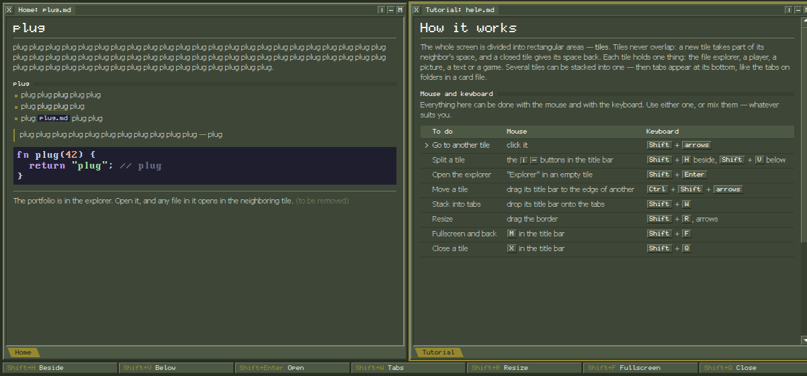
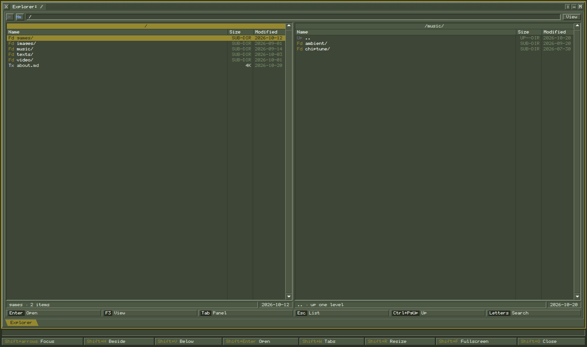
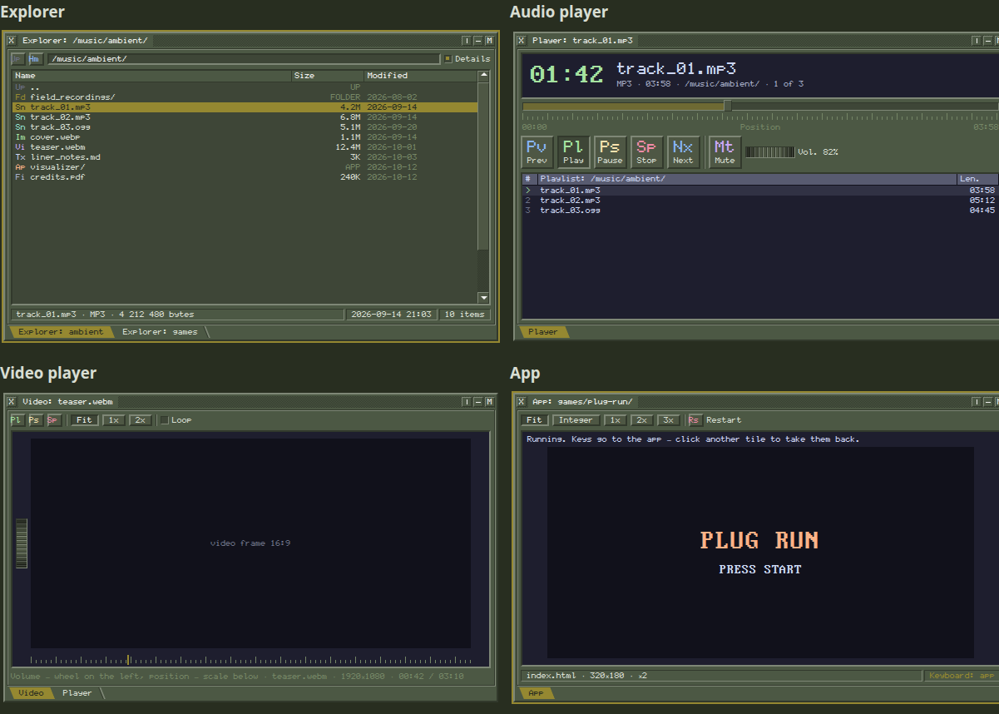

# MILK-FUMO

**A portfolio site shaped as a tiling desktop environment.** The whole site is the browser window divided into tiles, as in i3. The tiles hold pmc over the portfolio, notes, players and web apps. The content is a plain directory on the owner's server, served by nginx.

Status: **project description, UX and UI.** There is no site code yet. [`docs/prototypes/`](docs/prototypes/) holds the clickable prototypes the decisions were made on.

## Purpose

Within the first minute a visitor should:

1. read whose site this is;
2. read that it is a tiling desktop environment, and learn to use it;
3. see the portfolio and open any file from it.

**The core principle is freedom.** The original i3 is driven by the keyboard only. Here everything can be done with the keyboard only, with the mouse only, or with both mixed — whatever suits the visitor. Every action has both ways.

**View only.** A visitor opens files, plays, listens, seeks and rearranges their layout, but writes nothing to the published content. Publishing new work is a separate procedure: the owner uploads files over SFTP. Write protection comes from server file permissions, not from missing buttons.

## What it is built from

| Source | What we take |
|---|---|
| [bird-fumo](https://github.com/vydramain/bird-fumo) | viewers and launching: explorer, images, audio, video, web apps |
| [3dmppc-editor](https://github.com/vydramain/3dmppc-polymer/tree/master/editor) | look and behavior of the workspace: tiles, frames, tabs, minimum sizes; fonts. The design system is the editor's widget catalog ([`editor/src/catalog/`](https://github.com/vydramain/3dmppc-polymer/tree/master/editor/src/catalog)) |
| [vgui2-deck](https://github.com/vydramain/vgui2-deck) | palette; fonts, for the prototypes only |
| SGI IRIX | UI inspiration: raised frames, brass, dense utility type |
| Midnight Commander, Volkov Commander | pmc UX: two panels, cursor, F-keys |

### What bird-fumo has

| Capability | What is implemented | For the site |
|---|---|---|
| Explorer | Storage roots, folders, files, path, going back, open on double click | Rework into pmc, in the MC style |
| S3 access | Object listing, metadata, signed read URLs | Folder list as JSON from nginx; files by plain HTTP GET |
| Image viewer | PNG, JPEG, WebP; previous/next, name and position in the set | Keep |
| Audio player | MP3; play, pause, stop, seek, volume, mute | Keep |
| Video player | MP4 and WebM through the same media player | Keep |
| Sets | Opening media collects matching files from the folder | Keep |
| Text and HTML viewer | TXT and HTML in a nested iframe | Replace with Markdown notes |
| Web app launch | A folder with `index.html` is an app; it runs in an iframe, resources come from S3 | Keep, with the `.exe` name rule added: an app is a folder whose name ends in `.exe` and that contains `index.html` |
| App messaging | `APP_READY`, `OPEN_FILE`, title, errors over `postMessage` | Use as the base |
| Storage changes | Create folders, upload, rename, delete | Remove |
| Desktop | Floating windows, overlap, taskbar | Replace with tiles |

**OGG, WAV, FLAC and Markdown are not in bird-fumo's handler registry**; their support has to be added.

## How the site works

- This repository is the owner's personal page. It is to be deployed on the owner's server with docker-compose; the server runs other services too.
- The content is one directory on the server, the root of the site's content. The owner uploads files to it over SFTP; nothing has to run after an upload.
- The paths of the Home and Tutorial notes, and the content root the site starts from, are set in variables.
- nginx serves the site files and the content directory. The browser gets a folder listing from nginx as JSON (the autoindex module, JSON format: name, type, size, modification time). Files are plain HTTP GET requests.
- Visitors only read, over HTTP. Only the owner writes, over SFTP; write protection is server file permissions.
- Nothing is remembered between visits; the site leaves nothing with the visitor.
- The UI is downloaded once per visit and runs entirely in the visitor's browser. The page is HTML with a canvas, and the code is plain JavaScript modules, with no npm and no build step: the files in the repository are what the server serves.
- The site draws the whole interface itself, in one `<canvas>`, with the browser's Canvas 2D API and no libraries.
- Notes are drawn in the canvas too, so a visitor cannot select or copy their text.
- The exception is games and web apps: they run in an iframe placed over the canvas, in the rectangle of their tile. They are loaded from the same address as the site, which lets the environment catch `Shift+Q` even inside a game; all other keys go to the game, and a click on another tile gives the keys back to the environment.
- The interface is pixel-perfect.
- The UI is drawn in immediate mode, as ImGui (an immediate-mode GUI library) draws the editor: each frame is rebuilt from the state, with no tree of widget objects. A widget knows its rectangle while it is drawn and checks clicks on it itself.
- Drawing happens only on an event, not 60 times a second, so an idle page does not load the processor.
- Audio and video elements are created by the script and are not inserted into the page; video frames are drawn into the canvas.
- Pixel-perfect is achieved this way: the canvas buffer matches the screen's physical pixels; all coordinates are whole physical pixels; smoothing is turned off; text is drawn from bitmap font tables, not by the browser's text engine.
- Chromium and Firefox are both fully supported.
- About 100 visitors at the same time. The limit is the server's outgoing bandwidth for video and music: viewers multiplied by bitrate.
- Why not object storage: MinIO was archived in February 2026; the other open object-storage servers either do not list a folder without a key or are too heavy for this volume; one nginx container is simpler.

## UX

### Start screen

Two Markdown note tiles split **1:1**. Both notes are Markdown files in the content directory. No buttons: the start screen itself is the tutorial.

| Left: "Home" | Right: "Tutorial" — **focused** |
|---|---|
| Who I am and what is here (placeholder text `plug` for now). Below it the line "The portfolio is in pmc. Open it, and any file in it opens in a new tile on the right." (to be removed) | "How it works": what tiles are, then the table of actions "to do — mouse — keyboard" |

The table of actions marks progress: `✓` next to an action already done, `›` next to the action to try next, whose row is brighter.

The tutorial is written so that someone who knows i3 says "Oh! This is like i3!", and someone who sees tiles for the first time understands how to use them. The words "i3" and "desktop environment" do not count as an explanation.

### Tiles

- The whole screen is divided into rectangular tiles. **Tiles never overlap.**
- **A new tile shares the space with its neighbor 1:1.** A closed tile gives its space back.
- The layout is a tree of splits whose leaves hold tabs. Several tiles can be stacked into one — then tabs appear at its bottom, like the tabs on folders in a card file.
- A tile can be maximized to the whole screen and the layout restored.
- Mouse moves work as in the editor: a title bar dropped at the edge of another tile creates a neighbor, dropped in the center or on the tab strip stacks into tabs. The future place is highlighted; Escape cancels the move.

### Controls

The modifier key is **Shift**: in a browser test Shift worked in every combination, with Alt one combination was taken by a system shortcut, Super did not work. `Ctrl+Q` quits Firefox and `Ctrl+Shift+Q` quits Chrome, so closing a tile is `Shift+Q`. Keys are matched by physical position (`KeyboardEvent.code`), so they work in any keyboard layout.

The reasons below are design reasoning; they do not explain the test result above.

- **Why Shift:** neither the system nor the browser takes it, and it does not clash with a visitor's own i3.
- **Why not Super:** the desktop often takes it before the browser sees it. For an i3 user Super is usually their own modifier: `Super+Enter` opens a terminal in their real i3 and the site sees nothing, so exactly the visitors who should recognize i3 would be lost.
- **Why not Alt:** it reaches the browser, but the browser owns some of its combinations: `Alt+←` and `Alt+→` go back and forward, `Alt+D` focuses the address bar.
- **Why not `Ctrl+W`, `Ctrl+T` or `Ctrl+N`:** a page cannot catch them at all.
- **What Shift costs:**
  - It types capitals. In a text field `Shift+H` must type "H", so environment commands are off inside fields and a key to leave a field is needed. The site has few fields, so this matters less here.
  - `Shift`+arrows and `Shift`+click are the usual selection of text or of several files, and the modifier takes them.
  - The i3 layer `Mod+Shift`, used there to move and close windows, is lost: moving is `Ctrl+Shift`+arrows and closing is `Shift+Q`.
  - Games often use Shift for running.

| To do | Mouse | Keyboard |
|---|---|---|
| Go to another tile | click it | `Shift` + arrows |
| Split a tile | the `│` `─` buttons in the title bar | `Shift+H` beside, `Shift+V` below |
| Open pmc | "pmc" in an empty tile | `Shift+Enter` |
| Move a tile | drag its title bar to the edge of another | `Ctrl+Shift` + arrows |
| Stack into tabs | drop its title bar onto the tabs | `Shift+W` |
| Resize | drag the border | `Shift+R`, then arrows; `Enter` or `Esc` — done |
| Fullscreen and back | `M` in the title bar | `Shift+F` |
| Close a tile | `X` in the title bar | `Shift+Q`, also inside a game or app |

Holding one of the one-shot Shift keys Shift+H, Shift+V, Shift+Enter, Shift+W, Shift+F or Shift+Q does nothing extra; arrows repeat. Shift tile keys are handled before the pmc search; a repeated Shift tile key falls through to pmc search, so holding Shift+H adds a letter to the search, and only when the focused tile is pmc.

**The environment bar at the bottom is always visible.** It holds hints for every action, the first one being "`Shift`+arrows Focus". Every cell can be clicked and performs its action. Above the bar is a message line: for example, why a border will not move further.

The bar was added after focus could not be returned to the explorer from the keyboard in a prototype. A reproduction with real key presses showed that `Shift+←` worked, while `Tab` and `Esc` in the file tile did nothing, as designed. That the missing on-screen hint for moving between tiles caused this is a guess, not a proven cause.

### pmc

pmc (PSEUDO Midnight Commander) is the file panel: the UI is that of the editor's tiles, **the UX is that of the early Midnight Commander.**

- **Two panels inside one tile.** `Tab` switches the active panel. The path is written into the top frame of each panel, and the active panel's path is brass.
- The cursor is a full-width bar. `↑` `↓`, `PgUp` `PgDn`, `Home` `End`; the mouse wheel moves the cursor by 3 rows, a click puts it on a row. The cursor of the inactive panel goes dim.
- `Enter` or double click: a folder — enter it in the same panel, `..` — one level up, and the cursor stands on the folder that was just left, as in MC; a folder whose name ends in `.exe` is an app, and `Enter` launches it instead of entering it; a file — the tile splits into two equal parts, pmc stays on the left and keeps the focus, and the file opens in a new tile on the right, in the tile of its type. `Ctrl+PgUp` — one level up.
- `F3` — quick view: the other panel shows what the cursor is on: a folder — information about it, a track — the player with its set, an image — the image, a `.md` file — the note, an app — its screen. `F3` again or `Esc` brings the list back. `F3` is used instead of MC's `Ctrl+Q`, because `Ctrl+Q` quits Firefox.
- Letters — quick search by the start of a name, `Backspace` erases a letter, `Esc` clears the search.
- Columns "Name", "Size", "Modified", separated by vertical lines; folders are listed first and show `SUB-DIR` instead of a size, `..` shows `UP--DIR`. Under the list is a line about the file under the cursor and a total for the folder.
- There is no copy, move or delete (MC's `F5`–`F8`): the site is read only.
- At the bottom of the tile is its own MC key bar (`Enter`, `F3`, `Tab`, `Esc`, `Ctrl+PgUp`, letters). **Only pmc has it**; every key in it can be clicked.

### Tile types

| Type | Content | Reference |
|---|---|---|
| pmc | Published folders and files from the content directory, two panels | [`explorer.html`](docs/prototypes/explorer.html) |
| Note | Markdown text | both tiles of the start screen |
| Audio player | Time, position, buttons, volume, playlist from the folder | [`start-screen.html`](docs/prototypes/start-screen.html) |
| Video player | Frame, Fit / 1x / 2x, loop; volume as a wheel on the left, position as a scale below | [`start-screen.html`](docs/prototypes/start-screen.html) |
| App | A folder whose name ends in `.exe` and that contains `index.html`: a web game or another web app in an iframe; Fit / Integer / 1x / 2x / 3x, restart | [`start-screen.html`](docs/prototypes/start-screen.html) |
| Images | The selected image and switching through the set | [`explorer.html`](docs/prototypes/explorer.html) shows only the image well with the file name and size, without switching |

Several pmc tiles, notes, players and apps can be open at once.

### Main scenario

1. The visitor reads the start screen.
2. Opens pmc, enters the music folder and opens a track — a player appears beside it, pmc stays.
3. Opens a game and places it as they like.
4. Moves the player under pmc or stacks them into tabs.
5. Maximizes the game, then restores the layout.

**Rearranging the layout does not restart a game or cut the music.** App and player instances survive moving, stacking into tabs and maximizing. This is the key technical criterion.

### Minimum sizes

- The layout is designed for a **960×540 viewport**. A viewport smaller than that, or than the minimum of the current layout, scrolls instead of squeezing the tiles.
- A **screen** smaller than **960×540** (`screen.width × screen.height`) gets a "too small" screen with the required and the current size instead of the environment.
- A **mobile device** gets the same kind of screen with only the text "Sorry, we don't support mobile devices yet." A device counts as mobile when its primary input is touch: `(hover: none) and (pointer: coarse)`.

3dmppc-editor itself needs a 1280×720 display and sets 1280×720 as its minimum window size ([`rv_editor_too_small.cpp`](https://github.com/vydramain/3dmppc-polymer/blob/master/editor/src/app/rv_editor_too_small.cpp), [`main.cpp`](https://github.com/vydramain/3dmppc-polymer/blob/master/editor/src/main.cpp)). A browser viewport is smaller than its window, so the site sets its own minimums.

Measured on 2026-10-28 in maximized windows of Chromium 156 and Firefox 158 under the xfwm4 window manager on virtual screens, with clean profiles and no OS panel. Viewport sizes:

| Screen | Chromium | Firefox |
|---|---|---|
| 1280×720 | 1280×609 | 1280×611 |
| 1366×768 | 1366×657 | 1366×663 |
| 1920×1080 | 1920×973 | 1920×971 |
| 1920×1080 at 125% (1536×864 in CSS) | 1536×762 | 1536×763 |

The width stays the full screen width; the height loses 101–111 px: 20–24 px is the window title, the rest is tabs and the address bar (87 px in Chromium).

An OS panel takes more. The Windows 11 taskbar is 48 px at 100% ([Tom's Hardware](https://www.tomshardware.com/uk/how-to/change-taskbar-icon-size-windows-11)); for Windows 10, sources give about 40–42 px ([windowsnews.ai](https://windowsnews.ai/article/windows-11-taskbar-size-setting-compact-or-larger-without-registry-hacks.431307) and [wintips](https://www.wintips.org/?p=49356)), which differ. Chrome on Windows was not measured, and macOS was not checked. Estimated, not measured: on a 1280×720 screen under Windows 11 the viewport is about 1280×560–590.

A 1920×1080 laptop at 150% is 1280×720 in CSS pixels (calculated), so a 1280×720 screen is not only an old monitor.

Sizes considered: a 1280×720 viewport (it is the editor's window size, and a viewport is smaller than its window) and a 1280×560 viewport (from the Windows 11 estimate). The owner chose 960×540.

Mobile: a separate mobile mode, one tile with tabs at the bottom taken from a generated draft (Stitch), was considered. The owner chose only the "not supported" text. Tablets such as the iPad get that text too, since their primary input is touch; a laptop with a touch screen gets the environment, since its primary input is not touch.

Tile minimums follow the editor ([`rv_editor_shell_minimums.cpp`](https://github.com/vydramain/3dmppc-polymer/blob/master/editor/src/app/rv_editor_shell_minimums.cpp), [`rv_editor_workspace.cpp`](https://github.com/vydramain/3dmppc-polymer/blob/master/editor/src/ui/rv_editor_workspace.cpp), [`rv_editor_tile.cpp`](https://github.com/vydramain/3dmppc-polymer/blob/master/editor/src/layout/rv_editor_tile.cpp)):

- the minimum of a tile's content is 20 em (the width of "M") × 4 row heights, unless the content has its own;
- the minimum of a tile is the largest minimum of its tabs plus the frame, plus the tab strip when there is more than one tab;
- the minimum of a split is the sum of the minimums along its axis plus the splitter, and the largest across it;
- a border cannot be moved past a minimum, neither with the mouse nor with `Shift+R`; the message line says whose minimum is in the way.

Metrics at scale 1: font 8 px, em 6 px, padding 4 px, row height 16 px, frame bevel 3 px, tile frame 14×34 px, splitter 4 px.

Tile minimums for the prototypes, including the frame (chosen for them, not set by the editor; calculated from the constants in [`explorer.html`](docs/prototypes/explorer.html)): pmc — 546×156 (two panels, each with a 20 em name column plus size and date), player — 250×98 (five buttons), app — 334×214 (320×180 plus the frame), any other tile — 134×98 (20 em × 4 rows plus the frame). The prototype's pmc list rows are 12 px (explorer.html:139 `ROW = 12`), unlike the 16 px row height in the metrics above.

## UI

The look is IRIX through 3dmppc-editor:

- rectangles without rounding, a raised tile frame and a sunken content area;
- **a brass frame around the focused tile**;
- a dithered tile title bar: `X` on the left, `│` `─` `M` on the right;
- tabs are slanted folder tabs **at the bottom of the tile**, the active one is brass;
- pmc and notes sit on olive, players, apps and code in navy wells (Catppuccin Mocha, like Code and Game in the editor);
- file icons are two-letter codes instead of pictures.

Apart from the mobile mode, a generated draft (Stitch) gave two things: the split buttons `│` and `─` in the title bar, and a player queue from the folder, the same as bird-fumo's sets. Dropped from the draft: its own palette (`#101509` and its tokens), the Space Mono and JetBrains Mono fonts, Material icons, telemetry-style decorations (`MEM 64.2%`, `LATENCY`, `ETAG`) and a red close button; the 3dmppc-editor widget catalog and vgui2-deck are used instead.

### Palette

The main palette is defined in [`rv_editor_theme.hpp`](https://github.com/vydramain/3dmppc-polymer/blob/master/editor/src/theme/rv_editor_theme.hpp): the editor's own token table plus the state colors of vgui2-deck:

| Role | Color |
|---|---|
| Main surface | `#4C5844` |
| Sunken areas and fields | `#3E4637` |
| Buttons | `#4E5744` |
| Selection and focus — brass | `#958831` |
| Light frame bevel | `#7E8776` |
| Dark frame bevel | `#32392C` |
| Darkest surface | `#282E20` |
| Main text | `#D8DED3` |
| Bright text | `#F1F2F0` |
| Inactive text | `#758666` |

Wells use Catppuccin Mocha: background `#1e1e2e`, darkest `#11111b`, text `#cdd6f4`, muted `#a6adc8`, `#585b70`, `#6c7086`; accents: green `#a6e3a1`, teal `#94e2d5`, peach `#fab387`, blue `#89b4fa`, mauve `#cba6f7`, yellow `#f9e2af`, red `#f38ba8`.

### Icons

From the editor ([`rv_editor_glyphs.hpp`](https://github.com/vydramain/3dmppc-polymer/blob/master/editor/src/ui/rv_editor_glyphs.hpp), colors in [`rv_editor_pane_files.cpp`](https://github.com/vydramain/3dmppc-polymer/blob/master/editor/src/panes/rv_editor_pane_files.cpp)):

| Code | Meaning | Color |
|---|---|---|
| `Fd` | folder | brass |
| `Sn` | sound | teal |
| `Im` | image | green |
| `Tx` | text | text |
| `Fi` | other file | muted |
| `Hm` `Pl` `Ps` `Sp` `Rs` | home, play, pause, stop, restart | — |

New ones for the site: `Vi` — video (mauve), `Ap` — app (peach), `Up` — up, `Pv` `Nx` — previous and next, `Mt` — mute.

### Fonts

| Font | Where |
|---|---|
| `rv_font` 5×7 from pdklib | interface: title bars, tabs, keys, lists; note headings and body text |
| PxPlus IBM EGA 8×14 | text inside the Catppuccin wells (players, apps, code), small size, the default |
| PxPlus IBM VGA 9×16 | text inside the wells at the normal size; at the large size, the same font drawn twice as big |

The site's fonts are copied from 3dmppc-polymer, not from vgui2-deck: the `rv_font` bitmap tables of pdklib (`pdk/lib/include/pdklib/rv_font/`) and the PxPlus IBM EGA and VGA fonts. The size of text inside the wells is switched as View > code size in the editor. The site does not use WineTahomaBit.

The fonts reach the site as one JavaScript file of bitmap tables. The page tool `tools/fonts.html` makes it in a browser from those fonts: the `rv_font` tables in C++ and the PxPlus EGA and VGA TTF files. The file is committed; the site only reads it and does not depend on how the browser draws fonts. [`tools/build_rvfont.py`](tools/build_rvfont.py) builds an OTF for the prototypes only.

Pixel fonts are used only at their native size or a whole multiple of it.

PxPlus IBM VGA and EGA (VileR) are CC BY-SA 4.0; 3dmppc-polymer keeps them in `third_party/pxplus-ibm-vga/` with ORIGIN.md and the license. The whole rv_font is under CC BY-SA 4.0: its Cyrillic is redrawn from PxPlus, and the owner's ASCII part is licensed under the same terms (`pdk/lib/README.md` in 3dmppc-polymer). The tables made from PxPlus are CC BY-SA 4.0 too. Origins and licenses of the prototype fonts are in [`docs/prototypes/fonts/`](docs/prototypes/fonts/README.md).

### Markdown in notes

A first-level heading is `rv_font` at 16 px with a groove under it, a second-level one is `rv_font` at 8 px with a dithered rule. Body text is `rv_font`, code is PxPlus IBM EGA 8×14 on navy by default, keys are raised keycaps. A link in a note opens in a new browser tab. A note also has lists, quotes and horizontal rules. An earlier placeholder of the Home note showed every Markdown element: a list, a link, a quote, code and a horizontal rule.

A spoiler is text between two pairs of vertical bars (`||text||`); it stays hidden until clicked. Spoiler text is literal: keys, links and other marks inside it are not parsed. Notes have no tables, bold or italics. Absolute addresses must be http(s) without spaces; relative ones must not start with // and must not contain spaces, a colon, an ampersand or a backslash.

## Running

Both environments use `compose.yml` and an env file that sets `HOST_PORT` and `CONTENT_DIR`.

- **Dev:** `docker compose --env-file .env.dev up` serves the site at `localhost:8080`, with the fixture `dev/content`.
- **Prod:** copy `.env.prod.example` to `.env.prod`, set `CONTENT_DIR` (the content directory on the server) and `HOST_PORT`, then run `docker compose --env-file .env.prod up`. The port is published on `127.0.0.1` only; TLS and any public proxy are set up on the host.

The content directory is mounted read-only. The owner edits it over SFTP on the host.

## Architecture

The code structure below is a proposal and is not confirmed yet.

### Modules

- **metrics** — the scale and all sizes, as named constants.
- **layout** — a tree like `rv_editor_tile` in 3dmppc-editor (the tile model in Sources): a split node (axis, ratio) and a leaf (tabs, active tab), plus a maximized leaf. Operations: insert, remove, move (as a tab, left, right, top, bottom), activate, set_ratio, toggle_maximize. `min_size` and `place` are pure functions with no drawing.
- **panes** — the registry of tile instances: id → type, source file, key handler, close. An instance lives from opening to closing; the layout tree holds only ids.
- **workspace** — focus, resize mode, dragging, the message line, and a command table (an enumeration → a handler). Keys, cells of the environment bar and title-bar buttons all lead into this one table.
- **renderer** — the canvas, drawn in immediate mode; above it a layer of iframes. An iframe is created once and is then only moved or hidden, never moved to another place in the DOM. Audio and video elements are kept outside the DOM.
- **input** — Shift combinations by `KeyboardEvent.code` go to environment commands, other keys to the focused tile. Mouse: drop zones come from `place()`; dragging a border calls `set_ratio` and stops at the minimum. Inside a game, `Shift+Q` is caught through access to the iframe (same address).
- **catalog** — reading only: the folder listing (nginx JSON) and the URL of a file. pmc and the viewers know only this module.
- **tiles** — the tile types: pmc, note, audio, video, app, images; a table "extension → type".
- **app protocol** — taken from bird-fumo's `postMessage` messages without its privileged messages and token: `APP_READY`, title, error.
- **texts** — all interface texts in one file.
- **config** — the variables: the content root and the paths of the two start notes.
- **`tools/fonts.html`** — the generator of the font tables (already described under [Fonts](#fonts)).

### How the key criterion would be met

The criterion from Main scenario: rearranging does not restart a game or cut the music.

- Moving an `<iframe>` to another place in the DOM reloads it; `<audio>` and `<video>` removed from the document pause.
- So tiles are only rectangles in the canvas, and rearranging moves rectangles. Audio and video are created by the script outside the page. An iframe is created once and positioned over the rectangle of its tile.
- `Element.moveBefore()` keeps an element's state when it moves, but not every browser supports it, so the design does not rely on it.

### Rejected options

- **TypeScript with Vite** — many technologies and heavy tools, and a build step; the owner wants light tools and no build.
- **React** — it re-creates a component when its parent changes, which breaks the key criterion.
- **S3 storage** — MinIO is archived (February 2026, no images since October 2025); Garage does not give an anonymous folder listing; SeaweedFS is heavy; RustFS is beta and has CVE-2026-73290; anonymous listing in VersityGW was not checked. One nginx container is simpler.
- **A manifest file of the content instead of the folder listing** — the listing was chosen, because nothing has to run after an upload.
- **WebGL or WebGPU, PixiJS or Konva, imgui-js** — heavy for a 2D interface; Canvas 2D is enough.
- **`fillText`** — text smoothing differs between browsers, so the text would not be pixel-perfect.
- **Python in the project** — not needed; `tools/fonts.html` converts the fonts in the browser.
- **Apps packed as zip** — a browser cannot run a page from an archive without its own unpacker and a Service Worker.
- **Running games without access to the site page, or from a subdomain** — the environment could not catch `Shift+Q` inside the game.
- **PDF** — not needed; the formats are Markdown, images, audio, video and web apps.

## Prototypes

| File | What it shows |
|---|---|
| [`docs/prototypes/start-screen.html`](docs/prototypes/start-screen.html) | the start screen and references for the explorer, audio player, video player and app (static) |
| [`docs/prototypes/explorer.html`](docs/prototypes/explorer.html) | the explorer: MC keys, moving between tiles, the environment bar, resizing, maximizing, closing and minimum sizes work |

They open straight from the file in a browser (checked in Chromium). `explorer.html` follows the minimum size rules above: it needs a screen of at least 960×540 and shows the mobile screen on touch-first devices.

**Where the prototypes differ from this description:**

- in `explorer.html` a new tile opens at 2:1, not 1:1;
- `Shift+H`, `Shift+V`, `Shift+Enter` and `Shift+W` in `explorer.html` only say "not done";
- in `start-screen.html` the environment bar has no "`Shift`+arrows Focus" cell, and the explorer among the references still has one panel — the current explorer is `explorer.html`;
- the prototypes take the body text of notes from WineTahomaBit and the code from PxPlus IBM VGA 9×16;
- the prototypes are plain HTML and CSS pages that the browser lays out and draws, not canvas;
- the prototypes call pmc "Explorer";
- in `explorer.html` pmc cannot be closed (the message line says "The explorer cannot be closed in this prototype"), and while a tile is maximized focus does not move to another tile (the message line says "The tile is maximized — Shift+F restores the layout"). The description does not set either behavior yet;
- `start-screen.html` still says that a file opens in the neighboring tile, not in a new tile on the right;
- `start-screen.html` marks the next action with `>` and has no `✓` mark yet.

## Open questions

- **Where the switches are.** The switch of text size inside the wells (View > code size in the editor) has no place on the site yet: the site has no menu bar.
- **Code structure.** The modules under Architecture are a proposal, not confirmed.
- **Bandwidth for the other services.** The server runs other services; limiting the site's traffic with nginx `limit_rate` / `limit_conn` is under consideration, not decided.
- **Ports.** 80 and 443 are probably free on the server; the owner checks.
- **Configurable modifier.** Whether the modifier key can be changed, as `$mod` in an i3 config. Shift is the default.
- **Direct links and search engines.** A link to a specific game or track, and the state in the URL, are not designed. Search engines do not see content that appears only after JavaScript, and the site draws everything in a canvas.
- **Probes to run.** Whether Chromium and Firefox support `devicePixelContentBoxSize`; whether an iframe shifts off the pixel grid at fractional screen scales; whether an iframe keeps its state when tiles are rearranged.
- **Tab strip at the minimum tile (Q1).** The height of the tab strip at the minimum tile size is not settled.
- **VGA 9×16 ninth column (Q2).** The font generator drops the ninth column of PxPlus IBM VGA 9×16.
- **Note key style.** Keycaps in notes are raised, as this README says, or sunken, as the current code draws them; not decided.

## Sources

- bird-fumo: [handler registry](https://github.com/vydramain/bird-fumo/blob/master/front/lib/fp4/handler.ts), [launching and opening files](https://github.com/vydramain/bird-fumo/blob/master/front/Shell.tsx), [AppHost](https://github.com/vydramain/bird-fumo/blob/master/front/core/AppHost.tsx), [S3 operations](https://github.com/vydramain/bird-fumo/blob/master/back/src/fs.ts).
- 3dmppc-editor: [theme](https://github.com/vydramain/3dmppc-polymer/blob/master/editor/src/theme/rv_editor_theme.hpp), [theme application](https://github.com/vydramain/3dmppc-polymer/blob/master/editor/src/theme/rv_editor_theme_imgui.cpp), [fonts](https://github.com/vydramain/3dmppc-polymer/blob/master/editor/src/font/rv_editor_font.cpp), [tile model](https://github.com/vydramain/3dmppc-polymer/blob/master/editor/src/layout/rv_editor_tile.hpp), [workspace](https://github.com/vydramain/3dmppc-polymer/blob/master/editor/src/ui/rv_editor_workspace.cpp), [moves and drop zones](https://github.com/vydramain/3dmppc-polymer/blob/master/editor/src/ui/rv_editor_workspace_drag.cpp), [widget catalog](https://github.com/vydramain/3dmppc-polymer/tree/master/editor/src/catalog).
- vgui2-deck: [fonts and licenses](https://github.com/vydramain/vgui2-deck/tree/main/fonts).
