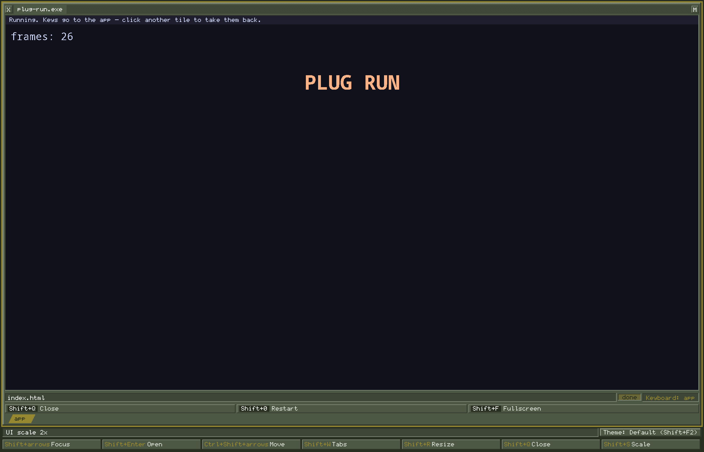
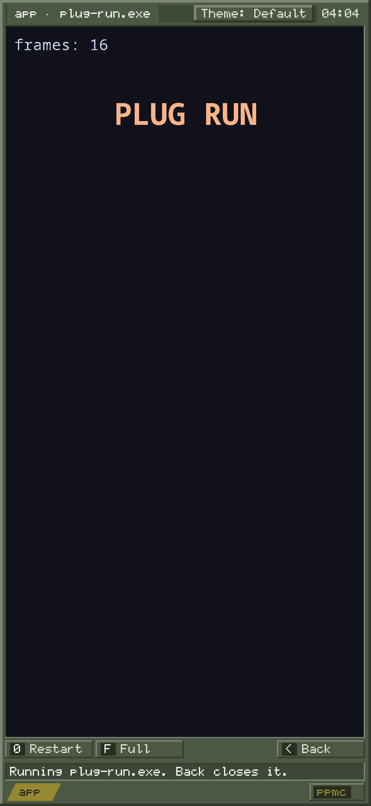
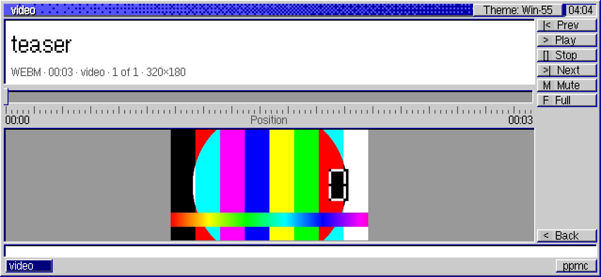
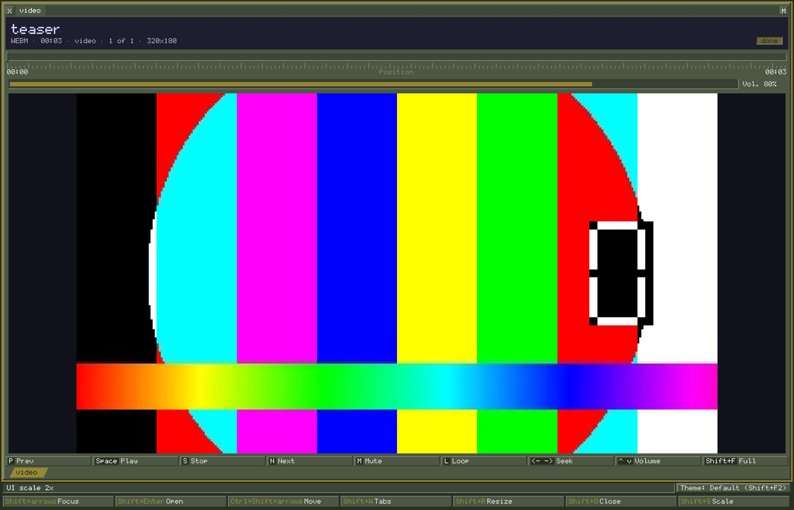
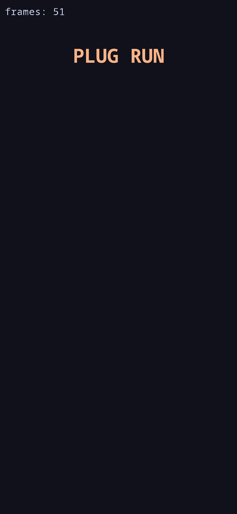
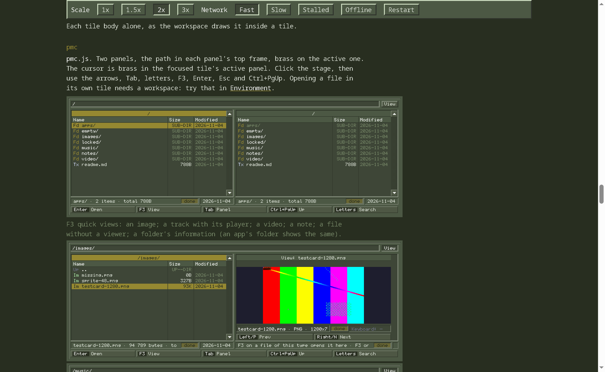
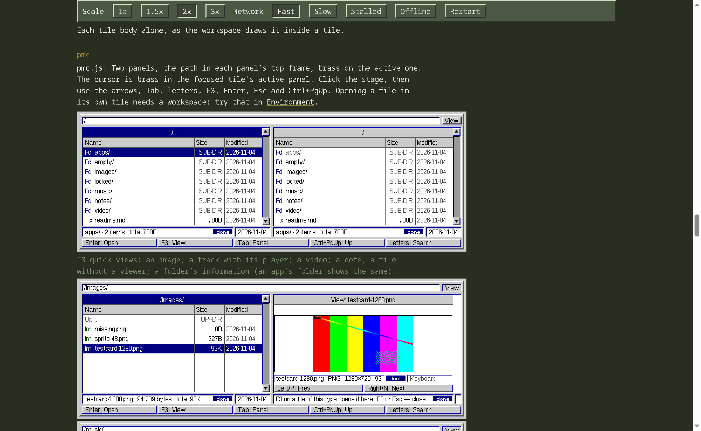
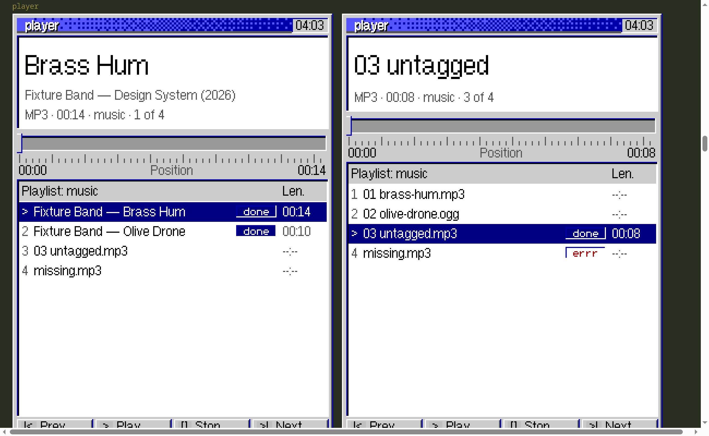
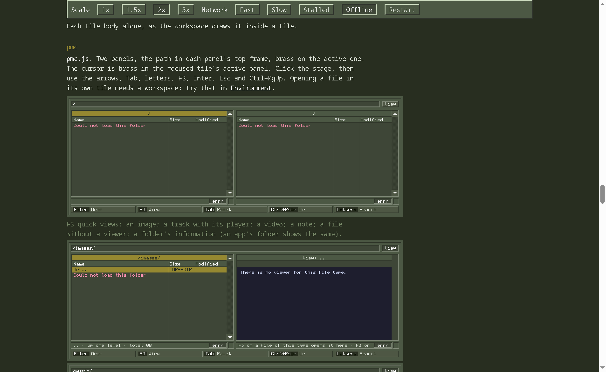

# Pocket audio and visual audit

Audit result for the integrated tree at `d8b97c1`. Automated browser evidence and screenshots were collected on Linux with Node 22.18.0, Chromium 156.0.8078.79 and Firefox 159.0.1. Chromium used headless CDP and touch emulation; Firefox used BiDi with a fresh profile. These runs are useful for layout and interaction checks, but are not physical phones.

## Acceptance criteria and DoD

| Item | Status | Evidence / remaining work |
|---|---|---|
| AC1 — Background audio | **Pending** | Pocket switching, rotation and player reopening kept the same live audio element and track position in emulation. Physical iOS Safari and Android Chrome lock, tab/app switch, and return checks remain. |
| AC2 — Playlist and stop | **Partial; physical confirmation pending** | Chromium reproduced and verified playlist advance, Pause at 3 s, Stop at 0 s, and no unwanted resume after Back. Phone lock/unlock and app-switch checks remain. |
| AC3 — Screen coverage | **Complete in emulation** | The inventories below were exercised in both themes; 60 desktop scenes and 37 Pocket scenes per run. App matrix covered desktop, Pocket portrait/landscape, minimum sizes, Full, loading and errors. |
| AC4 — Geometry and rendering | **Complete in emulation** | Measured DPR and overlay geometry, exercised Full and rotation, and verified the integrated fixes. See measurements below; no claim of independently comparing every physical pixel. |
| AC5 — Project review | **Complete for recorded scope** | UI, both design systems, app code, repo structure and docs were reviewed; fixes are integrated. Existing font/assets, licenses and attribution were preserved. |
| AC6 — Results and environment | **Complete** | Browser, OS, dimensions, DPR, limitations, and per-check outcomes are recorded here. |
| DoD1 — Background audio | **Pending** | AC1/AC2 phone tests need device models, OS/browser versions and results. Follow the reproduction checklist below. |
| DoD2 — Pixel-perfect | **Complete with platform limits recorded** | Matrices, representative images and measurements are included; the verified fixes were retested. Physical device comparison remains outside this emulated result. |
| DoD3 — Project review | **Complete** | Scope and outcomes are summarized below; the checked-in licenses and attribution remain in place. |
| DoD4 — Regression and startup | **Complete** | Integrated suite: 33/33 tests green. Dev compose build returned 0 (`No services to build`); dev/prod app returned HTTP 200, MP3 Range returned 206, both design pages loaded locally. No actual deployment was performed. |
| DoD5 — Handoff | **Documentation recorded** | This report and the plan carry the result. Commit/worktree cleanup is handled by the coordinating flow; this documentation task does not commit. |

## Coverage inventory

Desktop design-system scenes (60, grouped as rendered):

- Foundations and scale: `palette`, `type-rv`, `type-vga`, `kinds`, `scale-1`, `scale-15`, `scale-2`.
- Primitives: `frames`, `dithers`, `slant`, `pixels`, `scrollbars`, `loadbars`, `keybars`, `footbars`, `screen-small`.
- Error views: `error-400`, `error-403`, `error-404`, `error-405`, `error-414`, `error-415`, `error-500`, `error-503`, `error-link-404`, `error-link-415`.
- Workspace and bars: `tiles`, `maximized`, `drop-edge`, `drop-stack`, `bars-message`, `bars-shift`, `bars-move`, `bars-resize`, `favicon`.
- pmc: `pmc`, `pmc-image`, `pmc-audio`, `pmc-video`, `pmc-note`, `pmc-other`, `pmc-folder`, `pmc-states`, `pmc-unfocused`.
- Viewers and environment: `note`, `note-narrow`, `note-error`, `player`, `video`, `video-full`, `image`, `image-small`, `image-error`, `app`, `app-error`, `body-loading`, `body-noviewer`, `body-error`, `loadbar-motion`, `environment`.

Pocket design-system scenes (37, each exercised in Default and Win-55 across Fast, Slow, Stalled and Offline):

- Notes (3): start note, progress complete, another note in the existing note tile.
- pmc (6): root, cursor confirmation, folder listing, Back to parent, listing error, unsupported file.
- Player (3): portrait playlist, last/untagged track, landscape controls.
- Video (3): portrait, landscape, Full.
- Images (2): native-size centered image, oversized fitted image.
- Apps (5): running iframe, Full game, app load failure, four open tiles, six tabs constrained to iPhone SE layout.
- Devices (8): four listed phone profiles in portrait and their four landscape layouts.
- Links/errors (7): track link, folder link, explicit 404, malformed-link 400, landscape 404, simulated-network missing-file 404 and simulated-network unlistable-folder 403.

## App scenarios and measurements

- App openings: 64 final states, both themes, opaque canvas corners and zero uncaught exceptions. Files included main desktop, music folder, plain text, Markdown, audio, video, image, iframe and bad link. Tested desktop 1121×721 at DPR 2; Pocket 393×852 and 852×393 at DPR 3; desktop startup at 960×540 and 959×539; Pocket startup/video/error at 240×320. The separate 42-scenario interactive run included both 240×320 and 320×240 minimum-size Pocket layouts.
- Separate interactive run: 42 scenarios (30 regular plus 12 minimum-size Pocket), both themes. Desktop UI scale 1×/1.5×/2× at DPR 2; Pocket portrait DPR 3 and landscape DPR 2.625. Audio/video play, pause, seek to 40%, mute, stop, audio previous/next, Full video/game, Back and browser Full refusal were exercised.
- At desktop UI 1.5×, iframe CSS edges were Default `[7, 29.5, 1114, 646.5]`, Win-55 `[7.5, 30, 1113, 646]`; at DPR 2 their physical edges were integral. Full video used a 2242×1442 buffer with opaque corners and integer `drawImage` edges. Pocket Full covered `[0,0,1179,2556]` portrait and `[0,0,2237,1032]` landscape at DPR 2.625.
- Rotating Pocket 393×852 ↔ 852×393 at DPR 2.625 during Full preserved the live media elements and overlay dimensions. A Chromium hit test within 0.5 CSS px of a right/bottom edge may land on HTML; an inward 1 px touch exits Full and aligns the overlay with the Canvas. At DPR 3 a prior Full buffer missed 3 physical px at the right edge; this was the reason to include the recorded DPR-specific check.
- Pocket audio remained live while moving Player ↔ ppmc and rotating. Track position advanced Default `.116 → .290 → .317 s`, Win-55 `.125 → .300 → .326 s`. Back from Player removed the element. On desktop, a real fixture MP3 reproduced an `ended` event queued before Pause/Stop; the fix verified natural next-track start, Pause at 3 s and Stop at 0 s.
- No phone lock, OS app switch, battery lock, or physical touch behavior was tested. AC1 and DoD1 therefore remain open. Follow-up: on one iOS Safari phone and one Android Chrome phone, start a track; lock the screen for longer than the remaining track duration; switch browser tab/app; switch Pocket Player ↔ ppmc; return and record track/position; verify playlist advance; then separately Pause, Stop, and close before locking and confirm no sound resumes after unlock/return. Record phone model, OS and browser versions for each case.

Design-system sweep: 20 runs, 1,016 nonblank Canvas scenes, zero uncaught exceptions. Desktop ran both themes at UI 1×/1.5×/2× Fast and UI 2× Slow/Stalled/Offline; Pocket ran both themes through all four network modes at the fixed whole-pixel stage scale. Chromium Restart at Win-55 + 3× + Stalled retained theme, scale and network setting. The screenshots below are examples, not a pixel-by-pixel diff of every scene.

Default uses bitmap font tables. Win-55 text uses Canvas 2D; at 1.5×, bitmap font pixels may have uneven one/two-device-pixel widths, as documented. The Firefox run used a fresh profile. A reused Chromium profile once held a stale module cache with a named-export mismatch after code changed; clearing the cache and reloading resolved it. Refresh with a clean browser profile (or clear cached modules) after updating the implementation before treating a stale load error as a regression.

The design systems use their own checked-in `docs/design-system/content/` fixtures, distinct from the app's `example/` tree, with local fixture routing and a simulated network layer; they do not clone every production server behavior. The report does not establish deployment behavior. FontTools 4.68.0 rebuilt the Win-55 TTF from checked-in BDF with matching SHA-256 `1a1b56cd4cd87cb6347e357a89e838bec0a2af17d4c0cd451347a12e661af1b9`. Individual media provenance is not recorded; known fixture reuse came from `d1b30b4` and `a892550`.

The project review corrected Offline errors in the `video-full` and `pmc-folder` scenes, applied network changes to active demo downloads, and kept Pocket listing errors on the requested folder. It also removed a dead iframe message and an inactive start prompt, and reused the shared `TABS_LEFT` metric for the desktop tab strip. Existing licenses and asset attribution were retained. The corresponding commits are `6e63ad3`, `af2e6db`, `22c806a`, `e145f2b` and `6949fb9`. Audio and geometry fixes are in `fce21ca` and `06b8648`.

Chromium with touch emulation at 393×852 CSS pixels and DPR 3 confirmed the CSS Full fix in `d8b97c1`. With the browser fullscreen request rejected, the Win-55 game iframe grew from 376×748 to 393×852 CSS pixels. Back restored its original size and preserved the element and address. Forward passed through the Full history entry with the tile visible. Node tests also verified traversal to a later page and opening ppmc after Forward.

The design pages ran under Python 3.14.9 using the README command. Docker Compose 5.7.0 started dev and a local prod configuration through a Podman 6.1.4 socket. Both used the checked-in example content and nginx 1.27. The test ports were 18080 and 18081. The app and listing returned HTTP 200, a missing fixture returned 404, and an MP3 range request returned 206.

## Screenshots

| Evidence | Image |
|---|---|
| Desktop app |  |
| Pocket portrait |  |
| Pocket landscape |  |
| Desktop video viewer |  |
| Pocket video Full |  |
| Final iframe Full/Back state |  |
| Design system Default |  |
| Design system Win-55 |  |
| Pocket design system |  |
| Offline state |  |
